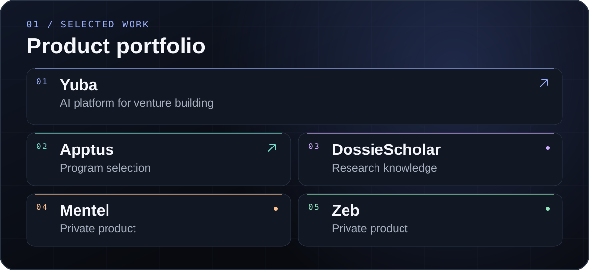
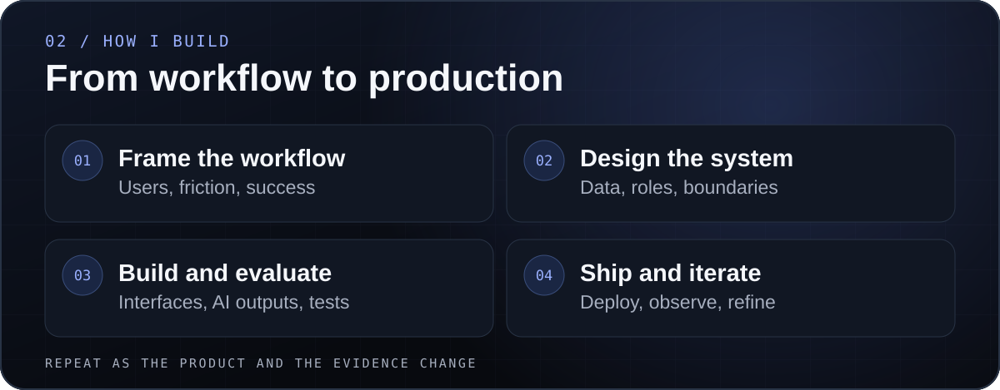
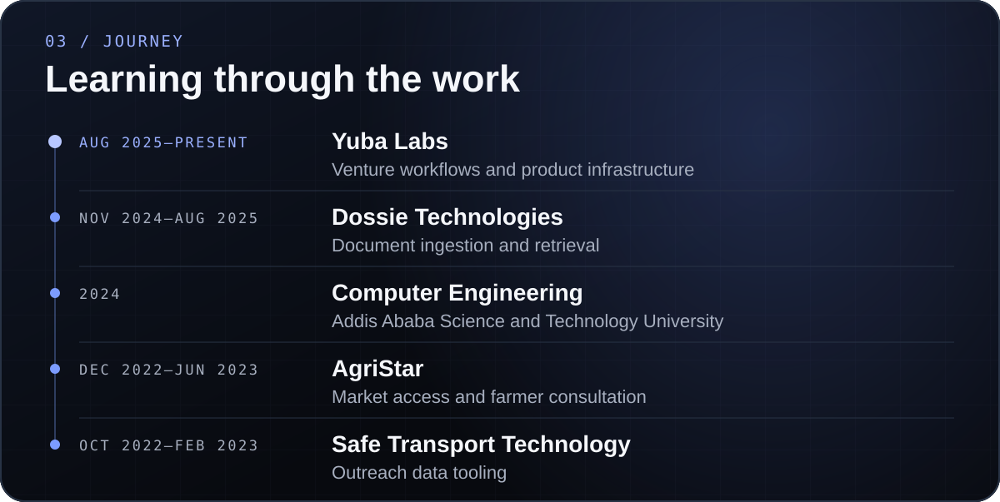
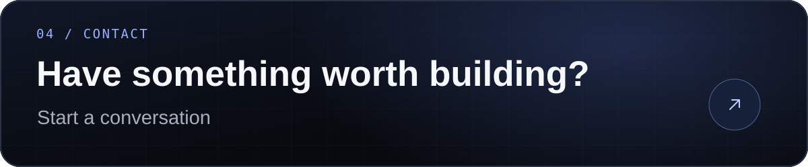

[Work](#product-portfolio) · [How I build](#how-i-build) · [Toolkit](#what-i-build-with) · [Journey](#journey) · [Portfolio](https://samuel-getachew.et/)

I’m **Samuel Getachew**, a software engineer and product lead based in Addis Ababa. I build AI-powered products from workflow design and data modelling through deployment, evaluation, and production troubleshooting.

## Product portfolio

### 01 · Yuba

A multi-organization AI platform for venture building. Founders work through structured validation workflows while program teams manage cohorts, portfolios, and role-specific workspaces.

`AI SaaS` · `Venture validation` · `Multi-tenant architecture`

[Product](https://yubanow.com/) · [Problem validation example](https://yubanow.com/shared/A5Wj5wZZfFN_9z2QaQpiaKarqULWHQ5NaEZZq3O3YVw)

### 02 · Apptus

An application and selection platform for entrepreneurship support organizations. Teams define application requirements, discover founders, and shortlist candidates against a rubric.

`Program operations` · `AI-assisted review` · `Rubric-based selection`

[Product](https://app.useapptus.com/)

### 03 · DossieScholar

A research knowledge platform that turns university papers into searchable records. The ingestion pipeline prepares documents for OCR, vector search, and retrieval-augmented generation.

`Document ingestion` · `OCR` · `RAG`

### 04 · Mentel

A private product built from an initial concept. Product context and engineering decisions are available on request.

`Private product` · `Zero to one`

### 05 · Zeb

A private build spanning product definition, interface design, and production engineering. Case study details are available on request.

`Private product` · `Software engineering`

[Selected work and contact](https://samuel-getachew.et/#work)

## How I build

1. **Frame the workflow.** Map who does what, where the work breaks down, and how to measure a better outcome.
2. **Design the system.** Define the data model, roles, permissions, and tenant boundaries before wiring up the interfaces.
3. **Build and evaluate.** Implement the workflow, define structured AI outputs, and test the paths that affect quality and throughput.
4. **Ship and iterate.** Deploy, investigate production issues, and turn what the team learns into the next change.

## What I build with

Curiosity drives the learning. Real problems shape the toolkit.

| Area | Tools and practices |
| --- | --- |
| **Intelligent systems** | Agentic workflows, RAG, PageIndex, LangChain, LangGraph, Azure OpenAI, Qdrant, pgvector, OCR, LLM evaluations, data pipelines |
| **Product engineering** | Python, TypeScript, JavaScript, SQL, React, Next.js, FastAPI, PostgreSQL, Supabase, REST APIs, Three.js, WebGL |
| **Architecture & delivery** | Product discovery, rapid prototyping, multi-tenant SaaS, authentication and RBAC, Azure, Redis, Celery, Locust, performance testing |

## Journey

- **Aug 2025–present · Yuba Labs.** Build AI workflows and product infrastructure across Yuba and Apptus.
- **Nov 2024–Aug 2025 · Dossie Technologies.** Built document ingestion, OCR, and retrieval systems for research knowledge.
- **2024 · Addis Ababa Science and Technology University.** Completed a bachelor’s degree in Computer Engineering.
- **Dec 2022–Jun 2023 · AgriStar.** Developed software for market access and consultation for smallholder farmers.
- **Oct 2022–Feb 2023 · Safe Transport Technology.** Built an outreach data collection tool during a software engineering internship.

## Contact

[Portfolio](https://samuel-getachew.et/) · [LinkedIn](https://www.linkedin.com/in/samuel--getachew/)
