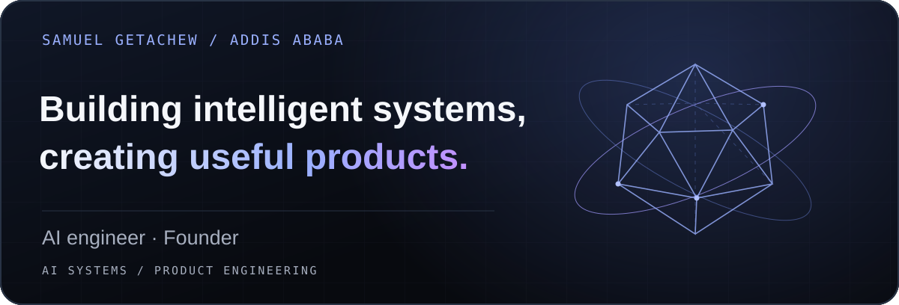

[Selected work](#selected-work) · [Experience](#experience) · [Writing](#writing) · [Portfolio](https://www.samuel-getachew.et/) · [LinkedIn](https://www.linkedin.com/in/samuel--getachew/)

I’m **Samuel Getachew**, an AI engineer, software engineer, and founder based in Addis Ababa. I build and evaluate AI agents for venture building, founder recruitment, and investment research. I also build knowledge systems that use AI to make documents searchable. At **Yuba Labs**, I lead development, agent workflow evaluation, and platform performance.

## Selected work

- **[Yuba](https://www.samuel-getachew.et/work/yuba/)** · Agentic AI for venture building. I co-designed and led a platform whose agents guide founders from problem discovery through market validation. I built evaluations for task completion and output quality, plus Locust load tests.
- **[YubaVC](https://www.samuel-getachew.et/work/yubavc/)** · Agentic AI prototype for investment research. I designed a workflow that combines web research and fact-checking into structured investment-readiness reports for human review.
- **[Apptus](https://www.samuel-getachew.et/work/apptus/)** · Agentic AI for founder recruitment. I designed and built a platform that helps programs find founders, tailor applications, assess submissions against a shared rubric, and shortlist candidates.
- **[Metus](https://www.samuel-getachew.et/work/metus/)** · 3D web engineering. I built a Three.js experience with five scroll-controlled scenes showing how whey from cheese production could be recovered for protein and animal feed.
- **[Dossie](https://www.samuel-getachew.et/work/dossie/)** · Enterprise AI and knowledge retrieval. I designed a platform to make information across physical records, documents, and databases searchable in one place.
- **[DossieClean](https://www.samuel-getachew.et/work/dossieclean/)** · Internal AI tool for document processing. I built a PDF workflow that uses GPT-4o mini to extract metadata for human review and generates embeddings for semantic search. It handled most of the document preparation behind DossieScholar’s collection of 15,000 university research papers.

## Experience

| Role | Focus |
| --- | --- |
| **Yuba Labs Ltd** · Co-founder & AI Engineer Aug 2025–present | Build and evaluate AI agent workflows for Yuba, Apptus, and YubaVC |
| **Dossie Technologies** · Co-founder & AI Engineer Nov 2024–Aug 2025 | Built OCR and retrieval-augmented generation (RAG) systems for research papers and studied AI-assisted medical record digitization |
| **AgriStar** · Co-founder & Software Engineer Jun 2022–Apr 2023 | Software connecting smallholder farmers with markets and agricultural advice |
| **Safe Transport Technology** · Software Engineering Intern Oct 2022–Feb 2023 | Telegram research tool and data collection for market analysis and outreach |

## Toolkit

- **Agentic AI** · LangGraph, LangChain, Azure OpenAI, and LLM evaluations.
- **Document AI and retrieval** · RAG, OCR, PageIndex, Qdrant, and pgvector.
- **Product engineering** · Python, TypeScript, React, Next.js, FastAPI, PostgreSQL, Supabase, and Three.js.
- **Architecture and delivery** · Multi-tenant systems, role-based access, Azure, Redis, Celery, and Locust.

## Writing

- [What Building AI Agents Taught Me About Web Access and Permission](https://www.samuel-getachew.et/blog/what-building-ai-agents-taught-me-about-web-access-and-permission/)
- [When Airline Crew Do Not Return: Forecasting the Staffing Risk](https://www.samuel-getachew.et/blog/airline-crew-nonreturn-machine-learning-staffing-risk/)
- [How AI Agents Could Change the Economics of Online Information](https://www.samuel-getachew.et/blog/ai-agents-economics-online-information/)

[All writing](https://www.samuel-getachew.et/blog/) · [Hobby Lab](https://www.samuel-getachew.et/hobby-lab/) · [Get in touch](https://www.samuel-getachew.et/#contact)
